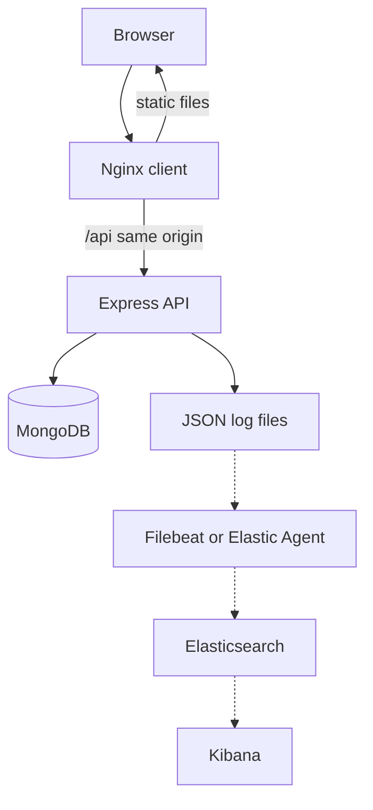

# FreelanceTrack

FreelanceTrack is a single-user web app for a freelancer. It keeps billable sessions on a month calendar and turns them into a monthly earnings view: total expected fees, session count, average fee, the top client, and a per-company breakdown.

The account is not registered in the app. The API compares the login form with `ADMIN_USER` and `ADMIN_PASS` from the environment and issues a JWT. The browser keeps that JWT in an httpOnly cookie. API clients can use the same token as a bearer header.

## Screenshots

Capture these after the first run and drop the files in `docs/` if you want them in the repo.

| Login | Calendar | Dashboard |
| --- | --- | --- |
| `docs/login.png` | `docs/calendar.png` | `docs/dashboard.png` |

## Quick start

Docker is the path to show a reviewer. Full steps, seed data, logs, and troubleshooting are in [SETUP.md](SETUP.md). A first install on a Linux server is in [docs/setup.md](docs/setup.md).

```bash
cp .env.example .env
docker compose up --build
docker compose --profile seed run --rm seed
```

Open http://localhost:3030 and sign in with the user from `.env` (`demo` / `demo1234` in the example).

## Changelog

Keep this section current. A later change, including one made with AI, should add an entry here before the work is treated as done. See "Improve Repo Maintainability" in [AI_Assisted_Workflow.md](AI_Assisted_Workflow.md).

### 1.2.1 — 2026-11-17

- Added `docs/setup.md`, a step-by-step Linux server install for someone setting the app up for the first time.

### 1.2.0 — 2026-11-17

- Companies are a catalog. Each company owns service types, and each pair has its own expected fee.
- A session copies that fee when it is saved. The fee is not typed on the session, and later catalog edits do not change sessions already saved.
- A company or service type cannot be deleted while a session still uses it.

### 1.1.0 — 2026-11-17

- Split the demonstration pipelines into DEV, Release, and Promotion. DEV runs on pushes to branches named `dev*`. Release and Promotion start only from `workflow_dispatch`.
- Moved the code scan into the DEV pipeline. JMeter stays outside GitHub Actions and is not run on every push.
- UI port is 3030. API port is 5050.

### 1.0.0 — 2026-11-17

- Initial FreelanceTrack app: month calendar, session create/edit/delete, monthly earnings dashboard, httpOnly JWT cookie, Pino JSON logs, Docker Compose, and seed data.

## What to show

1. Sign in. Refresh the page. The session should still be there, because the cookie is httpOnly and is not in `localStorage`.
2. On Companies, add or review a company and its service types. Each pair has its own fee.
3. On the calendar, click a day, choose that company and service type, and save. The fee is shown and is not editable. Click the event, switch the service type, then delete it and confirm.
4. Put two sessions on the same day. Both should remain visible.
5. Open Dashboard, change the month, and check the four summary cards plus the company lists. Totals use the fee stored on each session.
6. Open `server/logs/freelancetrack.log`. Each line is one JSON object with `runId`, `jobType`, `logType`, `startedAt`, `finishedAt`, and `durationMs`. The response header `X-Run-Id` matches `runId` for that call.

## Architecture



The UI is a Vite + React + TypeScript app. Nginx serves the built files and proxies `/api` to the Express server, so the cookie is first-party on port 3030. The server is stateless aside from MongoDB. A session is one document: start, end, service type, company, expected fee, and optional notes. The dashboard groups those documents for the selected calendar month.

In local development without Docker, Vite on port 3030 proxies `/api` to port 5050 for the same reason.

## Design choices worth explaining

**Cookie plus bearer token.** `POST /api/auth/login` sets `ft_token` as `HttpOnly`, `SameSite=Lax`, and `Path=/`, and it also returns the JWT in the JSON body. The React app never stores that body. It only calls `credentials: 'include'`. Postman and the JMeter plans use `Authorization: Bearer`. `SameSite=Lax` keeps the cookie off cross-site POSTs. When a browser does send `Origin` on a cookie-authenticated write, the API rejects origins that are not in `CLIENT_ORIGIN`. Bearer calls skip that check because they are not ambient cookies.

**Catalog fee.** A company owns service types, and each pair has one expected fee. Booking a session copies the company name, service type name, and fee onto the session. Changing the catalog later does not rewrite that copy. Choosing a different service type on an existing session copies the new pair’s current fee. Delete is refused while any session still points at that company or service type.

**Password check.** The plaintext password stays in the environment, which is what the spec asks for. On first login the process bcrypt-hashes it in memory and then uses `bcrypt.compare`. The username is compared with a timing-safe equality check. Failed logins return one message for a bad user or a bad password, and the password is not written to the log.

**Month boundaries.** The calendar asks for an explicit `from` / `to` instant, so the visible grid matches the browser timezone. The dashboard takes `year`, `month`, and an optional IANA `timeZone` (the browser sends its own). November in `Asia/Hong_Kong` starts at `2026-10-31T16:00:00.000Z`, not at UTC midnight. If `timeZone` is omitted, the server uses `APP_TIMEZONE`.

**Logs.** Pino writes the line, with `pid` and `hostname` removed, and the level formatted as `logType` (`DEBUG`, `INFO`, `WARN`, `ERROR`). Development consoles are pretty-printed. Production consoles and `server/logs/freelancetrack.log` are JSON, rotated daily, with 14 files kept and older files gzipped. That directory is the Filebeat input. `runId` is also returned as `X-Run-Id`.

## API

| Method | Path | Auth |
| --- | --- | --- |
| GET | `/health` | No |
| POST | `/api/auth/login` | No. Body `{ username, password }`. Sets the cookie and returns `{ username, token }`. |
| POST | `/api/auth/logout` | No. Clears the cookie. |
| GET | `/api/auth/me` | Yes. Returns `{ username }`. |
| GET | `/api/companies` | Yes. Companies with their service types and fees. |
| POST | `/api/companies` | Yes. Body `{ name }`. |
| PUT | `/api/companies/:id` | Yes. Rename. Does not rewrite existing sessions. |
| DELETE | `/api/companies/:id` | Yes. Refused with `IN_USE` while a session references it. |
| POST | `/api/companies/:id/service-types` | Yes. Body `{ name, expectedFee }`. |
| PUT | `/api/companies/:id/service-types/:serviceTypeId` | Yes. |
| DELETE | `/api/companies/:id/service-types/:serviceTypeId` | Yes. Refused with `IN_USE` while a session references it. |
| GET | `/api/sessions?from=&to=` | Yes. ISO datetimes, both inclusive on `startTime`. |
| POST | `/api/sessions` | Yes. Body includes `companyId` and `serviceTypeId`. The fee is copied from that pair. |
| GET | `/api/sessions/:id` | Yes |
| PUT | `/api/sessions/:id` | Yes. Replaces the session. The same pair keeps the stored fee. |
| DELETE | `/api/sessions/:id` | Yes |
| GET | `/api/dashboard/summary?year=2026&month=11&timeZone=Asia/Hong_Kong` | Yes |

Errors use `{ "error": { "code", "message", "details" } }`. Validation errors are HTTP 400. Missing or bad tokens are HTTP 401.

## Repository map

```text
client/     React UI, nginx config, client image
server/     Express API, Pino logger, seed, API tests
server/logs JSON log files when the API is running
jmeter/     Load and soak plans, run by hand outside GitHub Actions
security/   Fortify and Nexus IQ scripts used by the DEV code-scan stage
.github/workflows/dev.yml        DEV demonstration pipeline
.github/workflows/release.yml    Release demonstration pipeline
.github/workflows/promotion.yml  Promotion demonstration pipeline
```

The requirements used to build this are in [FreelanceTrack_PROJECT_SPEC.md](FreelanceTrack_PROJECT_SPEC.md).

## GitHub Actions are a demonstration

The workflows under `.github/workflows/` are for an interviewer to see the stage order. They are not a live production pipeline.

| Workflow | When it starts | Stages |
| --- | --- | --- |
| [DEV](.github/workflows/dev.yml) | Push to a branch whose name starts with `dev`, and manual `workflow_dispatch` | Initialize → Test → Build Code → Code Scan → Build Container → Deploy |
| [Release](.github/workflows/release.yml) | `workflow_dispatch` only | Initialize → Test → Build Code → Build Container → Deploy |
| [Promotion](.github/workflows/promotion.yml) | `workflow_dispatch` only | Initialize → Publish Container → Promotion |

No other workflow is meant to run on a push. JMeter is not part of these workflows. It is run by hand, outside the repository, and not on every push.

Before these pipelines can reach a real scanner, registry, or environment, create the following on the GitHub repository. Nothing in git contains their values.

Repository variable:

| Name | Purpose |
| --- | --- |
| `IMAGE_NAME` | Image name prefix. The workflows use `freelancetrack` when this variable is empty. |

Repository secrets:

| Name | Used by |
| --- | --- |
| `SONAR_TOKEN`, `SONAR_HOST_URL` | DEV Code Scan (SonarQube) |
| `FORTIFY_CLIENT_TOKEN`, `FORTIFY_URL` | DEV Code Scan (Fortify). The runner also needs `sourceanalyzer` or `scancentral`. |
| `NEXUS_IQ_URL`, `NEXUS_IQ_AUTH` | DEV Code Scan (Sonatype Nexus IQ). The runner also needs `nexus-iq-cli.jar`. |
| `DEV_DEPLOY_TOKEN` | DEV Deploy |
| `RELEASE_DEPLOY_TOKEN` | Release Deploy |
| `REGISTRY_URL`, `REGISTRY_USERNAME`, `REGISTRY_PASSWORD` | Promotion, Publish Container |
| `PROD_DEPLOY_TOKEN` | Promotion |

Without those secrets the scan, deploy, publish, and promotion stages still finish and print what they would have called. Test, Build Code, and Build Container do run: tests, `npm run build`, and `docker build` on the runner. The images from Build Container are not pushed.

## AI-assisted workflow

The short account below is the one to walk through with a reviewer. The same text is kept in [AI_Assisted_Workflow.md](AI_Assisted_Workflow.md). The files those checks correspond to are listed under [security/README.md](security/README.md) and [jmeter/README.md](jmeter/README.md).

### Tools used

- Cursor (primary AI coding assistant)
- Grok / ChatGPT (requirements clarification and project specification)
- Docker + Docker Compose
- MongoDB Compass
- Browser DevTools + Network tab
- Postman / Thunder Client

### Key steps

1. Clarified requirements with AI and produced a detailed project specification (`FreelanceTrack_PROJECT_SPEC.md`) covering architecture, data models, APIs, logging format, and acceptance criteria.
2. Used Cursor Agent mode to implement the application in vertical slices, guided strictly by the specification.
3. Reviewed and refined every major piece of AI-generated code before accepting it.
4. Integrated Docker, structured logging, seed data, and documentation.

### Approximate time spent

Approximately 10 hours total (specification, implementation, verification, polish).

### How the AI-produced results were checked

Verification was performed at multiple levels of rigor, balancing speed and thoroughness:

- **Lightweight review.** Every AI-generated change underwent a basic code review before acceptance, focusing on correctness, readability, and alignment with the project specification.
- **Multi-agent review.** For more complex changes, multiple AI agents were used collaboratively. At least one agent acted as an independent reviewer and evaluated the same change against the requirements and README.
- **Automated quality gates.** SonarQube, Fortify, and Sonatype are the Code Scan stage in the DEV demonstration workflow, `.github/workflows/dev.yml`. That workflow is not a production gate. See [GitHub Actions are a demonstration](#github-actions-are-a-demonstration) and [security/README.md](security/README.md).
- **API contract validation.** Request and response structures, status codes, and error handling are checked in `server/tests/api.test.ts`. The same calls can be repeated in Postman against a running API.
- **Performance and stability testing.** JMeter is run separately, outside this repository, and not on every push. The plans live in `jmeter/` so a run can be repeated by hand. Commands are in [jmeter/README.md](jmeter/README.md).
- **Log validation.** Output is JSON. `server/tests/logger.test.ts` checks `runId`, `jobType`, `logType`, timestamps, `durationMs`, and the session fields.
- **Final business verification.** Sign-in, calendar create/edit/delete, more than one session on the same day, and the monthly dashboard.

The original wording of this account is in [AI_Assisted_Workflow.md](AI_Assisted_Workflow.md).

## Cloud deployment considerations

This demo runs as one Docker Compose stack. A shared cluster would split the same processes apart. The API holds no session memory, so more than one replica does not need sticky cookies as long as every pod has the same `JWT_SECRET`.

### Helm

One chart with two deployments is enough:

```text
deploy/freelancetrack/
  Chart.yaml
  values.yaml
  templates/deployment-api.yaml
  templates/deployment-web.yaml
  templates/service-api.yaml
  templates/service-web.yaml
  templates/ingress.yaml
  templates/hpa-api.yaml
  templates/pvc-logs.yaml
  templates/externalsecret.yaml
```

`values.yaml` holds image tags, replica counts, `APP_TIMEZONE`, resource requests, and the ingress host. The JWT secret, admin password, and Mongo connection string do not belong in the chart. The web deployment is the nginx image. Its service is the ingress backend. It keeps proxying `/api` to the API service, so the browser still sees one origin.

### Horizontal Pod Autoscaler

Scale the API on CPU, with a memory ceiling so a leak shows up as restarts instead of a quiet node death. A starting point is min 2, max 6, CPU target 70%. The nginx deployment can use the same shape at lower requests. Do not autoscale a self-hosted MongoDB pod with this HPA. Give the API a PodDisruptionBudget of `minAvailable: 1` so a rolling deploy does not take both replicas at once.

### Active-active and multiple zones

Run at least two API replicas in different zones behind one ingress. Readiness is `GET /health`. Liveness is the same endpoint with a slower period. JWT auth means a request can land on either pod. MongoDB should be a replica set with members in more than one zone, or a managed cluster that already does that. The nginx tier is also stateless and can be doubled. Loss of one zone should leave one API replica, one web replica, and a mongo majority.

### Logs and volumes

A shared ReadWriteOnce volume is a poor fit for logs once there is more than one API pod, because only one pod can mount it. Prefer a Filebeat or Elastic Agent sidecar on each pod, reading the JSON files from an `emptyDir`, with the app rotating daily and keeping 14 files. Ship the line before the rotation deletes it. If a reviewer wants a PersistentVolumeClaim anyway, use one PVC per pod via a StatefulSet, not one volume shared by a Deployment. The Compose file bind-mounts `./server/logs` so a local demo can be read from the host. That pattern is for the laptop, not for the cluster.

### MongoDB

Use a managed service (Atlas or the cloud vendor's equivalent) for backups, failover, and patching. Keep the Compose `mongo:7` service for the demo and for a laptop. Point `MONGODB_URI` at the managed cluster in the secret, and restrict the network rule to the cluster egress. The app only needs a single database and an index on `startTime`, which the Mongoose schema creates.

### Secrets

`JWT_SECRET`, `ADMIN_PASS`, and `MONGODB_URI` should come from a secret manager through External Secrets, projected into the pod as environment variables. Rotating `ADMIN_PASS` takes a rolling restart because the process hashes it in memory on first use. Rotating `JWT_SECRET` logs every browser out, which is the right outcome. The image does not contain `.env`.

### Observability

Filebeat or Elastic Agent tails the JSON files, Elasticsearch stores them, Kibana is where you search `runId` or `jobType`. OpenTelemetry Collector into the same Elasticsearch cluster is a reasonable alternative if the platform already runs it. `runId` is the correlation id. `jobType` is the operation (`sessionCreate`, `login`, `dashboardSummary`, `httpRequest`). Alert on a rising ratio of `logType=ERROR`, on `/health` failures, and on API latency. The JMeter soak is the check for a slow leak before the HPA hides it by adding pods.

## Tests and builds

From the repository root, with dependencies installed in `server/` and `client/`:

```bash
npm test --prefix server
npm run typecheck --prefix server
npm run build --prefix server
npm run typecheck --prefix client
npm run build --prefix client
```

The API tests use an in-memory MongoDB. They cover login and the cookie, rejected passwords, session CRUD, two sessions on one day, validation, the cross-origin cookie block, dashboard totals, and a Hong Kong month boundary.
