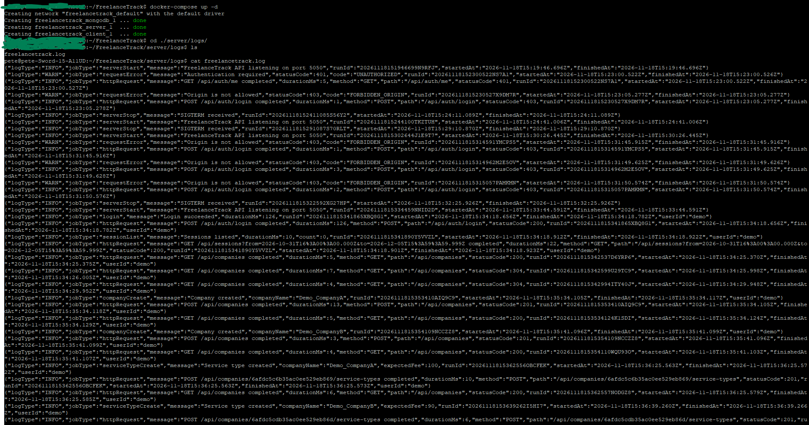

# Setup

This file is the local and Docker reference. If you are putting FreelanceTrack on a Linux server for the first time, follow [docs/setup.md](docs/setup.md) instead. It has every command in order.

FreelanceTrack runs as three containers: MongoDB, the API, and an nginx image that serves the UI and proxies `/api`. You can also run the API and the Vite dev server on the host and use only a local MongoDB.

## Prerequisites

- Docker Engine and Docker Compose v2 for the one-command path
- Node.js 20 or newer and npm, only if you run the API or the UI outside Docker
- A terminal in the repository root

The Docker images are `node:20-alpine` and `nginx:1.27-alpine`. The API image does not need a compiler. `bcryptjs` is pure JavaScript.

## Configure credentials

```bash
cp .env.example .env
```

Edit `.env` if you do not want the example user. `JWT_SECRET` must be at least 16 characters. Set `APP_TIMEZONE` to your IANA zone (for example `Asia/Hong_Kong`) if you call the dashboard without a `timeZone` query. The browser UI sends its own zone, so the on-screen dashboard still follows the laptop clock.

Leave `COOKIE_SECURE=false` while you use `http://localhost`. Set it to `true` only behind HTTPS, or the browser will drop the cookie.

`CLIENT_ORIGIN` must be the exact address in the browser bar, including `http://` and the port, with no slash at the end. Docker reads it from `.env`. `http://localhost:3030` and `http://127.0.0.1:3030` are different origins. To allow more than one, separate them with commas.

The example login is:

- Username: `demo`
- Password: `demo1234`

Change both before you share a deployed environment. There is no registration page.

## Start with Docker

From the repository root:

```bash
docker compose up --build
```

| Service | URL |
| --- | --- |
| Web UI | http://localhost:3030 |
| API | http://localhost:5050 |
| Health | http://localhost:5050/health |
| MongoDB | `mongodb://127.0.0.1:27017/freelancetrack` |

The UI on port 3030 is the one to open. It is same-origin with the API proxy, which is what the cookie needs. You can still call port 5050 from Postman or from a separate JMeter run with the bearer token returned by login.

Stop the stack with Ctrl+C, or `docker compose down` from another terminal. `docker compose down -v` also deletes the MongoDB volume.

## Seed demo sessions

Seeding **deletes existing sessions, companies, and service types**, then inserts four companies and ten sample sessions across this month and the previous month, including two sessions on the same day. Companies used: Acme Corp, Northwind Studio, Brightline Labs, Harbor & Co. The same service name can appear under more than one company with a different fee.

```bash
docker compose --profile seed run --rm seed
```

Run this after MongoDB is healthy. `docker compose up` does not have to be stopped first. The seed service uses the same database as the API.

## If Run MongoDB on the host instead of Docker

You still need MongoDB listening on `127.0.0.1:27017`. The Compose file can provide just that service, or you can use a local install.

```bash
cp .env.example .env
npm install --prefix server
npm install --prefix client
npm run dev --prefix server
```

In a second terminal:

```bash
npm run seed --prefix server
npm run dev --prefix client
```

Open http://localhost:3030. Vite proxies `/api` to http://localhost:5050, so the cookie stays on the Vite origin. The API reads `.env` from the repository root and from the current directory.

Production builds, without starting them:

```bash
npm run build --prefix server
npm run build --prefix client
```

`npm start --prefix server` runs the compiled API. The client build is static files in `client/dist`.

## JSON logs

Each line in `server/logs/freelancetrack.log` is one JSON object. The API also writes the same object to stdout. In Docker that stream is `docker compose logs -f server`. In development the console is pretty-printed and the file stays JSON.

A create looks like this:

```json
{
  "logType": "INFO",
  "runId": "2026111617000000ABC123",
  "jobType": "sessionCreate",
  "startedAt": "2026-11-16T09:00:00.123Z",
  "finishedAt": "2026-11-16T09:00:00.456Z",
  "durationMs": 333,
  "message": "Session created successfully",
  "userId": "demo",
  "sessionId": "674a1b2c3d4e5f6789012345",
  "companyName": "Acme Corp",
  "expectedFee": 1500
}
```

The file rotates daily. Fourteen files are kept, and older ones are gzipped. `LOG_LEVEL` accepts `debug`, `info`, `warn`, `error`, and `silent`.



Search a request by the `X-Run-Id` response header:

```bash
grep '"runId":"<id from the header>"' server/logs/freelancetrack.log
```

On Windows PowerShell, `Select-String` does the same job. MongoDB Compass can open `mongodb://127.0.0.1:27017` and the `freelancetrack` database if you want to look at the documents directly.

## Tests

```bash
npm test --prefix server
```

The tests do not use the Docker MongoDB. They start an in-memory server. The first run may download a MongoDB binary.

## Troubleshooting

**Sign-in says "Origin is not allowed".** The address you opened does not match `CLIENT_ORIGIN`. Set that line in `.env` to the address in the browser bar, for example `http://192.168.1.20:3030`, then recreate the API container:

```bash
docker compose up -d
```

**The UI loads and login appears to succeed, then the calendar sends you back to login.** You opened the Vite app and the API on two origins without the proxy, or `COOKIE_SECURE=true` on plain HTTP. Use http://localhost:3030. Keep `COOKIE_SECURE=false` for local HTTP.

**`docker compose up` waits forever on MongoDB.** Port 27017 is already taken, or the Docker engine is still starting. Stop the other MongoDB or change the host port in `docker-compose.yml`. `docker compose logs mongodb` shows the real error.

**The API exits immediately.** `.env` is missing, `JWT_SECRET` is shorter than 16 characters, or `ADMIN_USER` / `ADMIN_PASS` is empty. The process prints that requirement and exits.

**The log directory stays empty.** The API did not become healthy, or `LOG_TO_FILE=false`. The Compose service sets `LOG_TO_FILE=true` and mounts `./server/logs` at `/app/logs`.

**Dashboard totals do not match the calendar.** The dashboard month is evaluated in the timezone sent by the browser. A session just after local midnight can sit on the previous UTC date. That is expected. The API tests lock the Hong Kong boundary.

**Seed "connection refused".** MongoDB was not ready. Wait until `docker compose ps` shows mongodb as healthy, then run the seed command again.

**Port 3030 or 5050 is in use.** Stop the other process or change the published host port in `docker-compose.yml`. Inside Compose the API listens on 5050, and nginx proxies to `server:5050`.
